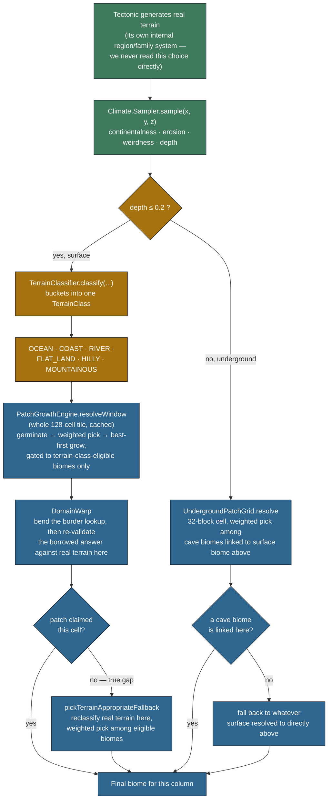

# Custom Overworld Biome Placement — Design Spec

Status: **implemented** (all 6 rollout milestones complete — patch size, terrain-class
gating, soft adjacency, underground linkage). Sections below are marked with what
changed during implementation vs. this original design; unmarked sections are still
accurate as background/rationale. See "As-built deltas" (§13) for the full list plus
known follow-up items deferred, not forgotten.

**Read `TERRAIN_COHERENCE_DESIGN.md` (same directory) before doing further work here.**
Real in-game testing after this doc's implementation exposed a deeper, architectural
problem this design cannot fix by further tuning: this modpack's terrain generator
(Tectonic, not vanilla) produces shape features (spires, ridges) largely decoupled from
the climate signal this `BiomeSource` reads, so biome-reacts-to-terrain (this whole
document's premise) can't guarantee the terrain/biome coherence the project actually
needs. The user has decided the next phase inverts that: biome decision should drive
terrain shape, not react to it, likely via modifying/forking Tectonic. That's a separate,
larger, not-yet-started project — this document's system stays in place and working
regardless, but it is not the final word on terrain/biome coherence.

Supersedes the TerraBlender-based `FilterRegion` approach that used to live in this mod
(`companion-mods/terrablender-custom-region`, now renamed
`companion-mods/mineutze-worldgen`) for the **Overworld only** -- Nether and End were
never migrated off TerraBlender, see §9's delta.

## 1. Goal

Replace vanilla/TerraBlender's nearest-point climate biome selection with an
author-controlled biome placement engine that guarantees:

1. Biomes match real terrain (no ocean biomes on dry land, no land biomes in open water).
2. Explicit adjacency control: "biome X may only border {A, B, C}" / "biome X must never
   border Y".
3. Explicit patch size control: "biome X is always at least N, at most M blocks across".
4. Terrain-class-correct placement: a biome tagged as mountainous only generates where the
   terrain is actually mountainous — never assigned to flat ground just because it fits a
   size/adjacency rule.

## 2. Why vanilla's system can't do this (background)

Overworld terrain shape comes from a `NoiseRouter` — density functions for continentalness,
erosion, weirdness (ridges/PV), depth. These produce actual block height (mountains, plains,
caves) independently of biome. Separately, `BiomeSource.getNoiseBiome(x, y, z, sampler)`
reads a `Climate.Sampler` — the same continentalness/erosion/weirdness/depth values, plus
independent temperature/humidity noise — to nearest-point-match a biome's registered
`Climate.ParameterPoint`s.

Vanilla's "frozen peaks only appear on jagged terrain" is not causal, it's curated
coincidence: Mojang hand-picked `frozen_peaks`'s climate point to sit in the same
erosion/weirdness zone their height spline maps to tall jagged terrain. Two independent
consumers of the same signal, correlated by hand-tuning, not enforced by code. Our old
`FilterRegion` anchor system inherited this same weakness, worsened by random per-anchor
erosion/weirdness sampling and a zero-width `depth` point — see git history on
`biome_grid.py` for the specific failure mode.

The fix: since `BiomeSource.getNoiseBiome` already receives the real
continentalness/erosion/weirdness/depth signal (the same one driving height), a custom
`BiomeSource` can gate biome eligibility on that signal directly instead of guessing via
anchor points.

## 3. Architecture overview

Two-tier patch system inside a custom `BiomeSource`:

- **Surface patch layer** (2D, x/z) — land and ocean biomes.
- **Underground patch layer** (3D, x/y/z) — cave/underground biomes (UndergroundWorlds).
- **Dispatch logic** — routes a given `(x, y, z)` query to the matching tier based on a
  real height estimate for that column (bounded, cached per column).

This replaces per-column independent nearest-neighbor lookup with explicit, cached region
patches — required for size and adjacency control, which are meaningless for a system where
patch shape is an accident of Voronoi cell density.

### 3a. Per-column resolution, step by step

What actually happens for one `getNoiseBiome` call today — **note we never read Tectonic's
internal region/family choice (club/heart/spade/diamond) directly**; we only read its
*output* (the climate signal), which Tectonic's family system already baked its influence
into upstream. Reading the family itself is Phase 2's proposal
(`TERRAIN_COHERENCE_DESIGN.md`), not how this works today.

Green = Tectonic's own output, read but not written by us. Amber = classification
(`TerrainClassifier`, the only place raw climate numbers get bucketed). Blue = placement
(`PatchGrowthEngine` and its tiers) — this is the part Phase 2 would make independent
of the green box entirely.

## 4. Terrain-class gating

Bucket the climate signal (continentalness, erosion, weirdness, depth) into terrain classes
per biome-cell:

- Surface: `ocean`, `coast`, `flat_land`, `hilly`, `mountainous` (exact cutoffs TBD, see §11).
- Underground: classes mirroring vanilla's own cave-biome bands (deep dark, lush caves,
  dripstone caves use specific depth/weirdness/PV ranges today — reuse the same signal).

Each biome declares its eligible terrain class(es) in config. Patch seeds only "germinate"
in cells matching one of the biome's classes — this is what prevents a mountain biome from
landing on flat ground. Class derivation reads directly off `Climate.Sampler` output; no
separate height sampling needed for classification (a coarser, cheaper proxy than actually
walking the density function stack). Thresholds need empirical calibration against this
modpack's actual noise router (see §11 — vanilla's own breakpoints are a starting guess only,
BOP/other mods may alter the router).

## 5. Patch generation algorithm

- **Seed placement**: deterministic Poisson-disc-style hashing per coarse region grid cell —
  `seed = hash(worldSeed, regionX, regionZ[, regionY for underground])`. Reproducible without
  precomputing the whole world.
- **Growth**: best-first flood-fill outward from each seed, subject to:
  - terrain-class eligibility (cell must match one of the biome's declared classes)
  - target size sampled per-patch from the biome's configured `[min, max]` range; growth
    stops at target or when blocked by ineligible terrain / a competing patch
  - soft adjacency scoring: growth priority favors cells bordering already-resolved patches
    on the biome's preferred-neighbor list; penalizes (does not hard-block) cells bordering
    the forbidden-neighbor list. Implemented as a weighted priority queue, not plain BFS.
- **Conflict resolution**: when two growing patches contest a cell, resolve by patch
  weight (reused from the old weight-slider concept) with a deterministic tie-break.
- **Caching**: resolved patch-id-per-cell memoized in a thread-safe map keyed by coarse
  region coordinate, computed lazily on first lookup. Must be safe under NeoForge's
  parallel chunk generation.

Adjacency is intentionally **soft**, not a hard constraint solver: no backtracking, no
dead-end handling required, deterministic and cheap. Accepted tradeoff — occasional
violated adjacency won't be visually obvious; escalate to a real constraint-propagation
approach only if it proves to be a real problem in practice.

## 6. Determinism requirements

- Growth must resolve using only bounded-radius neighbor state (cap lookahead to N region
  cells) — never require resolving arbitrarily distant, unrelated chunks first.
- Same world seed + same coordinates → same result regardless of exploration order or
  direction. Validate with an automated test: resolve the same region via two different
  simulated "discovery orders" and diff the output.

## 7. Underground (3D) tier

**AS-BUILT DELTA**: implemented much simpler than this section originally called for, and
the "exact 1:1 linkage" requirement (added after this doc was drafted) changes the
eligibility model entirely — see below.

Originally specified: full 3D version of the same patch/adjacency/size growth engine, per
decision to cover UndergroundWorlds biomes at full fidelity rather than a simplified
depth-band fallback, with terrain classes derived from vanilla's own cave-biome
depth/weirdness/PV bands.

What actually shipped (`UndergroundPatchGrid`): no growth engine at all. Each 32-block
coarse `(x, z)` cell (Y is not a growth axis here) independently does a weighted pick
among whichever cave biomes have that column's *specific* resolved surface biome
(`SurfacePatchGrid.resolve`, memoized) in their `undergroundLinkedSurfaceBiomes` list —
this is what "exact 1:1 linkage" (a requirement clarified after this doc was written)
actually needs: not a terrain-class band match, a specific-surface-biome match. No patch
size or adjacency underground in this milestone — that was never asked for, only
linkage was. Dispatch (surface vs. underground) uses the `depth` climate axis directly
(already what `FilterRegion.java`'s old `depth [0.2, 0.9]` underground entries exploited)
rather than a real height estimate — simpler, and depth already encodes "how far below
the estimated surface," so no separate height sampling was needed after all.

Unlinked underground columns (no cave biome links to that surface biome) fall back to
**the same biome as the surface directly above**, not vanilla's own dripstone/lush/
deep_dark placement — see §9's delta for why (same root cause: avoiding a second
uncertain vanilla-registry codec lookup for a payoff the actual requirements didn't ask
for). Known, disclosed limitation, not an oversight.

## 8. Config / data model (replaces `biome_settings.json` / `paint_*.json`)

Per biome:

- `terrain_classes`: list (replaces old `ZONE_LAND`/`ZONE_OCEAN`, extended with
  hilly/mountainous/underground-band classes)
- `size_min`, `size_max` (unit TBD — see §11)
- `preferred_neighbors`: list of biome ids
- `forbidden_neighbors`: list of biome ids (soft-penalized, not hard-blocked)
- `weight`: patch frequency / growth priority (reused from the old system)

**AS-BUILT DELTA**: the Streamlit app's role never shifted — it was deleted outright
instead. `pythonScripts/worldgen/app.py` and everything only it used (`biome_grid.py`,
`biome_nearest_neighbour.py`, `app_auto_layout.py`, `app_slices.py`, `app_world_paint.py`,
`app_world_map.py`, `app_coverage.py`, `app_data.py`, `biome_constraints.py`,
`entry_pipeline.py`, plus the already-orphaned `app_constraints.py`/`app_tile_editor.py`/
`tile_assignments.py` and the standalone `visualize_biome_layout.py`/
`visualize_world_map.py`) are gone — none of it could be salvaged, since all of it was
built around climate-anchor concepts (weight/zone/temperature/humidity ranges) that have
no counterpart in the patch-growth model at all. The "tune this patch-generator config
and preview the resulting layout" UI this section describes was **never built** — that
was always separate scope from the 6 rollout milestones, deliberately skipped. Right now
there is no UI: tuning `BiomeConfigRegistry.java` means hand-editing that Java file and
rebuilding/redeploying the mod. The Python port of the growth algorithm
(`patch_engine.py`/`patch_seed_hash.py`/`terrain_classifier.py`) was also dropped after
the fact, once it became clear its stated justification ("faster than a Gradle rebuild")
didn't hold up in practice (`compileJava` alone runs in seconds here) and hand-porting
every algorithm fix to two languages was a real, ongoing cost for a preview UI that was
never built. Its determinism check now lives in Java directly
(`PatchGrowthEngineSelfTest`, `./gradlew selfTest` — no deployMod, no game launch).
`calibrate_terrain_classes.py` survives; it's independent log-parsing/bucket-math with no
dependency on the growth algorithm itself. A real authoring pipeline (`patch_config.json`
+ a new Streamlit tab, per §12) is still open work, not done — if it gets built, a Python
port of the algorithm may become worth reintroducing for the preview to drive against.

## 9. TerraBlender removal

**AS-BUILT DELTA**: TerraBlender is NOT fully dropped — only the Overworld half. This
was a deliberate scope decision (confirmed with the user, not a fallback): Nether and
End keep `FilterNetherRegion`/`FilterEndBiomes` exactly as they were, still using
TerraBlender's `Region`/`EndBiomeRegistry` APIs and the raw scanned climate positions.
The mod's `build.gradle` keeps the TerraBlender `compileOnly` dependency and
`neoforge.mods.toml` keeps the `terrablender` dependency block, permanently, not as a
migration-window artifact. Only the Overworld's `FilterRegion.java` was deleted and
replaced.

- **Overworld**: fully custom `BiomeSource` (`CustomOverworldBiomeSource`), registered via
  a dimension JSON override (`data/minecraft/dimension/overworld.json` → `"type":
  "mineutze_filter:custom_overworld"`) and a `DeferredRegister<MapCodec<? extends
  BiomeSource>>` (`ModBiomeSources`) — matches what this section originally called for.
- **Nether/End**: unchanged, still TerraBlender, as described above.

## 10. Mod restructuring

**Done.** `companion-mods/terrablender-custom-region` → `companion-mods/mineutze-worldgen`,
`com.mineutze.filtermod` → `com.mineutze.worldgen`, `FilterMod` → `WorldgenMod`. The
NeoForge modId stayed `mineutze_filter` (not renamed) — only harmless auto-regenerated
cache files referenced it, not worth the churn.

## 11. Effort / risk summary

- **Terrain-class calibration**: tooling shipped (`/dump_height_samples` +
  `pythonScripts/worldgen/calibrate_terrain_classes.py`, smoke-tested against synthetic
  data), but the actual calibration run against this modpack's real noise router has
  **not** been done yet — `TerrainClassifier`'s erosion/weirdness thresholds are still
  the original placeholder guesses. Still an open risk, just no longer a tooling gap.
- **Determinism of patch growth**: validated, now directly in Java —
  `PatchGrowthEngineSelfTest` (`./gradlew selfTest`) resolves the same window twice
  sequentially and eight times concurrently, asserting byte-identical results, which is
  the property that actually matters given `PatchGrowthEngine.resolveWindow` has no
  external "scan order" parameter to vary (its internal iteration order is always
  fixed) — the germination local-maximum rule and seed-derived tie-breaks are what make
  that guarantee hold. No test framework needed, a plain `main()` class was enough. The
  original Python prototype's equivalent (`run_determinism_self_test`, two different
  scan orders) is what caught the patch-identity determinism bug in the first place —
  real value at the time — but the check itself has since been fully superseded by the
  Java version, not just duplicated.
- **3D underground performance**: turned out not to apply — the underground tier shipped
  without a growth engine at all (§7's delta), so this specific risk is moot as
  implemented. A **different**, real performance risk showed up instead on the surface
  tier: see the hang investigation below.
- **Python tooling migration**: did not happen as "migrate incrementally" — the old UI
  was deleted outright once superseded (§8's delta), since none of its code was
  reusable against the new data model.

### Real hang investigated and fixed during implementation (worth keeping as institutional memory)

World creation hung on "Scanning for structures" twice during development, for two
different real reasons, both fixed:

1. An early per-query-window design had **no cap on how far growth could extend** — an
   effectively-unbounded placeholder `size_max` meant a single cache miss grew forever
   outward, sampling `Climate.Sampler` without limit. Fixed by hard-capping growth at a
   resolution window's rectangular boundary regardless of target radius.
2. Window radius derived directly from the largest configured `size_max` with **no
   ceiling** — raising one biome's `size_max` in config alone nearly quadrupled the
   per-cache-miss cost and reproduced the same symptom without an actual infinite loop.
   Fixed with a hard radius ceiling independent of configured values.
3. Separately (not a hang, but confirmed via real profiling data — thread timing logs
   showed lock-wait roughly equal to compute time across ~2600 window resolutions during
   one world creation, several minutes total): the original design used **one global
   lock** (`synchronized` on the whole `SurfacePatchGrid` instance) serializing all of
   NeoForge's parallel chunk-generation worker threads, and **did not cache gap cells**
   (cells no patch's growth reached), causing redundant full recomputation for nearby
   queries. Both fixed by switching from ad-hoc per-query overlapping windows to a
   **fixed-size grid of tiles**, each resolved once via `ConcurrentHashMap.computeIfAbsent`
   (real per-tile concurrency, gaps permanently known once a tile resolves) — see §5's
   caching note, this is much closer to what that section originally specified
   ("memoized... keyed by coarse region coordinate") than the ad-hoc window design that
   preceded it. Accepted tradeoff: patches are now hard-clipped at tile edges (~1300
   blocks apart), a coarser and far less visible version of the very chunk-alignment
   problem this whole rewrite exists to fix (§2) — deliberate, not accidental.

## 12. Open items / next steps

- **See `TERRAIN_COHERENCE_DESIGN.md` first** — the actual next priority, a larger
  architectural pivot (biome-driven terrain instead of terrain-driven biome), not one of
  the smaller items below.
- Run the real terrain-class calibration (tooling exists, hasn't been executed against
  real generated terrain yet) — still worth doing regardless of the above, though no
  longer expected to be sufficient on its own (see `TERRAIN_COHERENCE_DESIGN.md` §3).
- Build the real config authoring pipeline: `patch_config.json` + a datapack reload
  listener + a new Streamlit tab. `BiomeConfigRegistry.java` is genuinely temporary
  scaffolding, not just in name — every tuning change today requires a Java edit and a
  full mod rebuild/redeploy.
- ~~Add a Java-side determinism test~~ — done (`PatchGrowthEngineSelfTest`, §11).
- See §13 for concrete, deferred bug follow-ups (cave variety; rivers and border noise
  are fixed).

## 13. As-built deltas not covered above

Requirement 3 ("cave biome X always under overworld biome Y") was clarified as an
**exact 1:1** linkage after this doc's original draft, which had assumed the underground
tier would be independent (§7's delta covers the resulting mechanism change). Requirement
2 (soft, not hard, adjacency) was confirmed as drafted — no change there.

Size unit (left TBD in the original §8/§11): resolved as **radius in blocks**, sampled
per-patch-instance from `[size_min / 2, size_max / 2]`.

**Domain-warped boundary lookup, not in the original design.** Even with the tile-radius
fix (§11's hang investigation) and the cohesion bonus (§5's delta, requirement 2's
follow-up), edges were still fundamentally cellular-automaton-shaped: a discrete
best-first BFS over a 16-block grid, not the continuous-noise-driven boundaries vanilla
gets "for free" because biome selection there is nearest-neighbour over smooth climate
fields. Discrete structure is what gives us authored size/adjacency/terrain-class
control at all (the whole reason this rewrite exists, §2) -- but it means edges read as
grid-shaped unless something explicitly reintroduces organic variation.

Fix: `DomainWarp` (new, `patch` package) perturbs the (x, z) position with a smooth,
bilinearly-interpolated value-noise field (deterministic, built from `PatchSeedHasher`,
no external noise dependency) -- but ONLY at the final read in
`SurfacePatchGrid.resolve()`, when a block asks "whose cached answer do I use." It never
touches germination, growth, size targets, adjacency scoring, or terrain classification --
those all keep running on the clean, unwarped grid, so size/adjacency guarantees don't
move. Correctness-critical detail: a warped/borrowed neighbor's answer is only accepted
after re-checking it against the REAL terrain class at the exact unwarped query position
(`classifyBlock`, finer-grained than the once-per-cell `classifyCell` growth uses) -- this
makes it structurally impossible for the warp to place a biome on terrain it isn't
eligible for (e.g. desert can never appear on real ocean-classified terrain via the warp,
because the check rejects it before returning). The warp noise's smoothness is load-bearing,
not cosmetic: verified via a standalone check (no Minecraft dependency) that adjacent
blocks' offsets differ by at most ~1 block, never jump -- a sloppy per-cell-random warp
would speckle instead of wobble.

A post-processing step not in the original design: `dissolveSmallIslands`
(`PatchGrowthEngine.java`; the now-dropped Python port had an equivalent
`dissolve_small_islands` too, while it existed). Real symptom found during testing —
a germination point deep inside what becomes a much larger neighboring patch's territory
can pass its own local-maximum check and then get boxed in almost immediately, leaving a
small isolated "island" of one biome inside another. Fixed with a post-growth pass:
contiguous same-biome components smaller than ~30% of their biome's own expected minimum
size get reassigned to whichever bordering biome is dominant AND terrain-class-eligible
for every cell involved. Snapshot-then-apply, not mutate-while-deciding, or two adjacent
small islands' outcomes would depend on which got processed first.

**Border noise between similar-weight biomes sharing a terrain class — fixed.** e.g.
plains and forest (both `FLAT_LAND`-eligible, similar weight) produced a visibly noisy/
scattered border before settling into solid territory further in. NOT the same failure
mode as the small-island bug above — border freckles were topologically connected back
to their main body through a winding path along the frontier, so the dissolve pass's
connected-component check never caught them (they weren't isolated). Real cause:
`computeCellScore` had no "cohesion" term rewarding a contested cell for having more
already-resolved same-biome cardinal neighbors, so ties along a contested frontier were
decided by near-coin-flip tie-break noise instead of favoring a compact, smooth edge.
Fixed with `SAME_BIOME_COHESION_BONUS_PER_NEIGHBOR` (0.2 per already-resolved
same-*biome* cardinal neighbor, deliberately not same-*patch* — two separate patches of
the same biome should still cohere near each other) added directly into
`computeCellScore`, orthogonal to `PREFERRED_NEIGHBOR_SCORE_BONUS` (that rewards
bordering a *different* macro-preferred biome; this rewards bordering *more of the same*
biome — both can apply to one cell). Determinism reverified (`./gradlew selfTest`) since
this changes the score function.

**Rivers/lakes — fixed.** Land biomes could overshoot into inland water because
`TerrainClassifier` only saw continentalness/erosion/weirdness, and a river/lake cell can
carry the same macro continentalness as the dry land around it. Added `TerrainClass.RIVER`,
detected via `abs(weirdness) <= RIVER_WEIRDNESS_ABS_HI` (a placeholder band, same
calibration caveat as the other thresholds — not yet run against real terrain) checked
before the flat/hilly/mountainous bucketing, and a `minecraft:river` `BiomeConfig`
restricted to it. Because the eligible RIVER area is itself naturally thin/winding (it's
literally the near-zero contour of the weirdness field), patches growing within it come
out thin and winding too without needing any special-cased shape logic — the same
circular-target-radius growth algorithm just naturally can't expand sideways out of a
band that isn't there to expand into.

**Gap fallback picked an arbitrary default — fixed.** `CustomOverworldBiomeSource`'s
original Milestone-1-era fallback for a true gap (no patch's growth ever claimed that
cell) was `BiomeConfigRegistry.allConfigs().get(0)` -- "whatever's first in the
configured list." Confirmed, not hypothetical, real failure mode: germination-priority
suppression (`isLocalMaximum`) isn't restricted to same-terrain-class competitors, so a
tiny, isolated terrain feature (e.g. a small mountainous speck) can lose its own
germination bid to a nearby, unrelated, higher-priority candidate; if no other patch's
growth reaches it either, the crude fallback would silently mislabel it as whatever
biome happened to be first in the list (plains) regardless of what's actually there.
Fixed: the gap fallback now classifies the real terrain at the exact query position
(`TerrainClassifier.classifyAtBlock`, extracted as a shared utility -- also de-duplicates
what `SurfacePatchGrid.classifyCell`/`classifyBlock` were already doing) and picks a
weighted-random biome among whichever configured biomes are actually eligible for that
terrain class (`PatchGrowthEngine.pickWeightedBiome`, made public for this reuse) -- the
same selection rule germination itself uses, just invoked directly for the one cell that
needs it instead of via the normal seed-and-grow path.

Known, deferred (not fixed, not forgotten — tracked as follow-up tasks):

- **Cave-biome variety for unlinked underground**: see §7's and §9's deltas — unlinked
  underground columns get their surface biome's ID rather than vanilla's own dripstone/
  lush/deep_dark placement. Fixable by wrapping vanilla's default `MultiNoiseBiomeSource`
  as the fallback instead (needs a second registry lookup,
  `Registries.MULTI_NOISE_BIOME_SOURCE_PARAMETER_LIST`, threaded through the codec) — not
  done because it wasn't something any stated requirement actually asked for, and adds a
  real chunk of uncertain-API risk for that alone.
