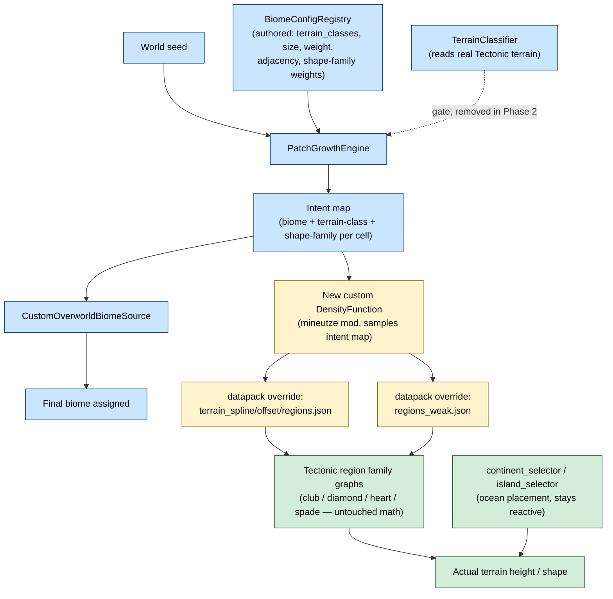

# Terrain Coherence — Phase 2 (goal for the next session)

Status: **investigation complete (§4a/§4b/§4c), implementation not started.** All five
original open questions (§4) are answered — license, placement decoupling, mechanism,
graph mapping, terrain-quality scoping. This document exists so a fresh conversation can
pick up exactly where this one left off without re-deriving any of the investigation
below. Do not start implementing from this doc without the user's explicit go-ahead in
that session — it captures a *decision about direction and a concrete mechanism*, not
an approved implementation plan.

Phase 1 (everything in `DESIGN.md` — the custom `BiomeSource` replacing TerraBlender,
patch-growth placement, terrain-class gating, domain-warped borders, underground
linkage) is **done and working**. This document is about a deeper problem Phase 1's
testing exposed, which Phase 1's architecture cannot fix no matter how much more it gets
tuned.

## Architecture at a glance

Blue = Phase 1, done. Yellow = Phase 2, planned/not built. Green = untouched either way.

Reading it: today (Phase 1, blue), `PatchGrowthEngine` only emits a biome where real
Tectonic terrain already matches (`TerrainClassifier` gate). Phase 2 (yellow) strips
that gate so the same engine emits a pure intent map from seed + config alone, then
feeds it into Tectonic's own region-family selector via one new density-function type
and two file overrides — everything downstream of that (yellow `FAM` box onward) is
Tectonic's existing, untouched shape math. Ocean/continent placement (green) never
enters this picture at all — see §4b.

## 1. The problem, precisely

Phase 1's whole premise (`DESIGN.md` §2): a custom `BiomeSource` can read the same
climate signal (continentalness/erosion/weirdness) that drives terrain shape, and gate
biome eligibility on it directly, instead of guessing via hand-placed anchor points like
TerraBlender did. This is a **reactive** design: climate noise → terrain shape (computed
by the world generator, independently) AND climate noise → biome decision (computed by
us). Biome selection *reacts* to whatever terrain the generator already decided to make;
it can never *cause* terrain to be a particular shape.

This modpack's terrain generator is **Tectonic** (`minecraft/mods/tectonic-3.0.19-neoforge-1.21.1.jar`),
not vanilla — this was not known when Phase 1's architecture was designed. Tectonic
replaces vanilla's NoiseRouter with its own, and critically: **its "region" system**
(internal names: club/diamond/heart/spade) that produces dramatic shape features
(jungle pillars, badlands/spade ridges, general jaggedness) is driven by noise
(`region_selector`, `continent_selector`) that is only **partially** correlated with the
climate axes we can read — enough that calibrating our thresholds against real generated
height would likely improve the *broad* picture, but specific named shape features are
layered on top via what amounts to separate noise, decoupled from what our
`TerrainClassifier` can see. Confirmed symptom: sand spires generating inside
desert-assigned areas, jungle pillars outside jungle-appropriate terrain, terrain in
general "not consistent with biome at all" per direct user testing.

No amount of tuning `TerrainClassifier`'s thresholds fixes this, because the information
needed to predict a spire isn't fully present in the signal we're allowed to read. The
mismatch is architectural, not a calibration gap.

## 2. Decision made at the end of the Phase 1 conversation

The user has decided: reactive biome-follows-terrain, even perfectly calibrated, cannot
give the coherence guarantee the project needs ("a desert is a huge plain of sand with
little water, not negotiable"). The fix has to invert the causality: **our biome
placement decision (size, adjacency, terrain-class intent) must drive terrain shape, not
react to it.** This will likely require modifying or forking Tectonic's terrain
generation — the user states Tectonic is MIT-licensed, which if true means this is
legally open — **this has not been independently verified in this conversation, confirm
it before any forking/code-reuse work begins.**

## 3. What was considered and explicitly rejected as insufficient

- **Calibrate `TerrainClassifier` against real Tectonic-generated height** (tooling
  already built and working: `/dump_height_samples` + `calibrate_terrain_classes.py`,
  including a river/depression pass — see `DESIGN.md` §13). Would help the broad
  correlation, confirmed real signal exists (Tectonic's `biome_parameter/erosion` does
  incorporate `region_selector`), but was never expected to fully solve named,
  semi-independent shape features like spires. Not wasted work — still worth running for
  whatever residual improvement it gives — but not sufficient alone, and the user moved
  past this before it was even run.
- **Datapack-override the specific named Tectonic density functions responsible for the
  worst mismatches** (`data/tectonic/worldgen/density_function/region/heart/jungle_pillar.json`,
  `region/club/badlands_ridge.json`, `region/spade/{upper_tier,lower_tier}.json` — exact
  paths confirmed by extracting and reading the jar's bundled resource pack, see §5).
  Technically sound and low-risk (climate signal is computed before final terrain shape
  in the generation pipeline, so gating those specific layers on our biome decision
  isn't circular), and was proposed as an honest 80/20 — kills the most visible mismatches,
  leaves Tectonic's base region/continent shape untouched. **User wants to go further
  than this** — a targeted override of a few named features still leaves the *base*
  terrain shape (which region a location falls in at all) fully outside our control.

## 4. What's believed necessary now (unconfirmed — real investigation needed)

Full inversion: compute the biome/size/adjacency/terrain-class decision essentially
independent of reading Tectonic's *shape* output (may still read raw climate-ish noise
for broad placement, or may not need to at all), then make terrain generation —
Tectonic's own density function graph, forked and modified, or a new one built to match
its quality — **constrained by** that decision rather than the reverse. This is a much
larger undertaking than anything built in Phase 1; treat it as its own project, not a
continuation/patch.

Open questions for next session's investigation phase (research first, no code):
1. ~~Verify Tectonic's actual license terms~~ **RESOLVED, see §4a.**
2. ~~Map Tectonic's *full* density function graph~~ **RESOLVED, see §4b.**
3. ~~Decide whether biome *placement* can run fully decoupled from real terrain signal~~
   **RESOLVED, see §4a.**
4. ~~Decide the actual mechanism~~ **Mechanism identified, see §4a — exact set of nodes
   to override still depends on Q2.**
5. ~~Scope how much of Tectonic's terrain *quality* survives the intervention~~
   **Narrowed to a bounded design task, see §4c** — no longer an open research
   question, structurally resolved by §4b's mechanism; what's left is authoring work.

## 4a. Investigation findings (this session)

**License (Q1) — resolved, user accepts.** Confirmed MIT three independent ways: jar's
own `META-INF/mods.toml` (`license = "MIT"`), Modrinth project API
(`api.modrinth.com/v2/project/lWDHr9jE` → `license.id: "MIT"`), and CurseForge listing
(user-confirmed). One wrinkle found and noted for the record: the GitHub source repo
(`Apollounknowndev/tectonic`, branch `rewrite-squared`) has **no LICENSE file** —
`api.github.com/repos/Apollounknowndev/tectonic` reports `license: null`, README has no
licensing mention. So there's no formal license *grant text* to cite, only the
author's consistent self-declaration across jar metadata and both mod-listing sites.
User has weighed this and is fine proceeding on that basis — not revisiting unless new
information surfaces.

**Placement decoupling (Q3) — resolved: yes, cleanly, no `PatchGrowthEngine` redesign.**
Traced every read of real terrain signal in `PatchGrowthEngine.java`
(`biomesource/patch/`). It has exactly three touchpoints, all hard *filters*, none
feeding the scoring/selection math:
- `eligibleBiomesForTerrainClass` (germination candidate filter)
- the terrain-class check inside `pushEligibleNeighbors` (growth-time filter)
- `isEligibleForEveryCell` (dissolve-small-island replacement filter)

Everything else — weighted biome pick, local-maximum germination spacing, best-first
growth scoring (weight + same-biome cohesion + preferred/forbidden neighbor bonuses +
seed tiebreak), target radius sampling — is a pure function of
`(worldSeed, cellX, cellZ, BiomeConfig)`. Stripping those three filter call sites is
enough to make the engine emit a full biome-placement map from seed + authored config
alone, with **zero terrain read** — this becomes the terrain-class *intent* map. So all
of Phase 2's redesign weight sits on Tectonic's side; none of it lands on
`PatchGrowthEngine`'s core algorithm.

Caveat raised and accepted: OCEAN/COAST/RIVER probably can't go full-intent the same
way — water plausibly still needs to react to real low elevation, or risks
floating/buried oceans. Doc §6 already flagged this; treat as still-open, decide
explicitly when scoping Q4/mechanism work, not assumed either way.

**Mechanism (Q4) — identified: datapack override + one new custom density-function
type, not a Tectonic fork/reimplementation.** Tectonic's shape graph
(`region/{club,diamond,heart,spade}/*`, `terrain_spline/offset/regions.json`, etc.,
per §5) is **JSON data**, not compiled code. Minecraft's normal datapack resource-ID
override mechanism already lets our mod replace any of those JSON files without
touching Tectonic's jar, mixins, or source at all — this is exactly how §3's rejected
"targeted override" idea worked mechanically, just scoped wider now.

The missing piece: JSON density functions have no way to read our Java-computed intent
map. Fix: register **one new custom `DensityFunction` type in our own mod** (pure new
code, zero Tectonic code copied or forked) that samples `PatchGrowthEngine`'s intent map
per-column, then datapack-override the specific Tectonic JSON nodes (`region_selector`,
`jungle_pillar`, `badlands_ridge`, spade tiers, spline offsets — exact full list is Q2's
job) to reference it.

Net effect: keeps almost all of Tectonic's actual spline/region math and "beautiful
terrain" quality intact (§4 pt 5's tension), only gates/parameterizes the specific nodes
that need to consume our biome intent. Substantially lower blast radius than either
"fork Tectonic's compiled mixins" or "reimplement Tectonic's generator from scratch" —
neither is needed for the JSON-expressed majority of the graph. One known exception:
§5's "not yet determined" Java-side mixin config sliders (`NoiseState.class`,
`NoiseBasedChunkGeneratorMixin.class`) — if Q2's mapping finds these load-bearing for
compliance (not just cosmetic tuning), *that* specific piece may still need actual
decompiling/forking. Won't know until Q2 is done.

> **Correction from §4b (Q2's actual mapping):** the guess above that we'd need to
> override each named shape file individually (`jungle_pillar`, `badlands_ridge`, spade
> tiers) was wrong — turned out unnecessary. The real override surface is two files:
> `terrain_spline/offset/regions.json` and `regions_weak.json`. See §4b for why.

## 4b. Investigation findings continued (Q2 — density function graph mapping)

Extracted and traced the jar's bundled resourcepack (`resourcepacks/tectonic/`, only
`overlay.mod` active — confirmed via `minecraft/config/tectonic.json`: `no_carvers`
absent/false, `ultrasmooth: false`, and neither `terralith` nor `mr_clifftree`/`clifftree`
installed, so the other conditional overlays never apply). Full graph lives under
`resourcepacks/tectonic/data/tectonic/worldgen/density_function/` (base pack, ~65 files;
`overlay.mod` only touches `__constants/*` and `terrain_spline/offset/final.json`).

**Router entry points** (`resourcepacks/tectonic/data/minecraft/worldgen/density_function/overworld/noise_router/`):
vanilla's `continents.json`/`erosion.json`/`ridges.json` slots are each a trivial
`minecraft:add` redirect to `tectonic:noise/full_continents` /
`tectonic:biome_parameter/erosion` / `tectonic:biome_parameter/ridges`. `final_density.json`
chains into `tectonic:base_terrain` → `tectonic:sloped_cheese`, which is where the
actual land-shape system lives.

**The region-family selector — the single highest-leverage node.**
`terrain_spline/offset/regions.json` (+ `regions_weak.json`, a softer-magnitude variant
blended alongside it) is a nested spline with exactly two input axes:
- outer coordinate `tectonic:noise/continent/erosion` — picks the *bracket*: low erosion
  → club / club_weak / heart family, high erosion → spade / spade_weak / diamond family
- inner coordinate `tectonic:noise/region_selector` (its own largely-independent noise
  field, `tectonic:region/selector`) — picks the specific member within that bracket

Once a family is picked (e.g. `region/heart`), that region's own sub-graph
(`jungle_pillar.json`, `rolling_hills.json`) runs unconstrained by biome — but that's
fine by construction: if family *selection* is already biome-intent-driven, pillars only
ever generate inside cells where intent already wanted jungle-shaped terrain. **No need
to override the named shape-feature files individually** — overriding the two selector
files above is sufficient. This corrects the individual-node-list guess in §4a.

**Erosion's shared root, and why we don't touch it.** Traced
`tectonic:noise/continent/erosion` and `tectonic:biome_parameter/erosion` (the
vanilla-read biome-climate axis) back to the same raw octave,
`tectonic:__constants/noise/erosion` — confirms §5's "erosion does incorporate region
info" claim at the source. Overriding that shared raw octave was considered and
rejected: it would alter general terrain roughness *everywhere*, not just region-family
selection, which is exactly the terrain-quality loss Q5 worries about. Overriding
`terrain_spline/offset/regions.json`/`regions_weak.json` directly instead avoids this —
the shared erosion octave, and hence vanilla biome-climate matching elsewhere, stays
untouched.

**OCEAN/COAST/RIVER caveat (§4a, originally from §6) — resolved, not just guessed.**
Ocean/continent placement runs through a wholly separate axis
(`continent_selector`/`island_selector`/`terrain_spline/ocean.json`) that never
references `region_selector` at all. Clean split confirmed: leave that axis reactive
and untouched; only the land-shape family layer (`regions.json`) becomes
intent-driven. No conflict between the two systems.

**Revised mechanism, concretely:** one new custom `DensityFunction` type in our mod
(samples `PatchGrowthEngine`'s intent map per column) + datapack-override exactly
`terrain_spline/offset/regions.json` and `regions_weak.json` (swap/blend their
`coordinate` inputs to read our function instead of / alongside
`tectonic:noise/continent/erosion` and `tectonic:noise/region_selector`). Everything
else in Tectonic's graph — ocean/island placement, roughness, mountain ridges/weathering,
underground rivers, lava tunnels, caves — stays completely untouched.

Still unconfirmed: exact numeric range our custom function needs to emit to land in the
right spline brackets (regions.json's breakpoints are roughly ±0.02 to ±0.1 on the
erosion axis, ±0.01 to ±0.1 on region_selector) — that's implementation-detail tuning,
not architecture, deferred to when this is actually built. §5's Java-side mixin-slider
exception still stands, unresolved either way.

## 4c. Q5 — terrain-quality tradeoff, narrowed (this session)

User's framing, agreed with in full: whether Tectonic's terrain quality survives the
intervention comes down to two levers, both under our control, neither automatable:

1. **Shape attributed to each biome** — which Tectonic region family (club/diamond/
   heart/spade + weak variants) a biome declares as its desired shape. These family
   names are internal codenames with no inherent semantic tie to biome identity (heart
   happening to hold `jungle_pillar` is a naming accident, not a pattern) — which family
   "feels right" for desert vs. swamp vs. mountain is aesthetic judgment. No amount of
   data-driven calibration can derive this; it has to be hand-authored, the same way
   `terrain_classes`/`size`/`weight`/neighbors already are in `BiomeConfigRegistry`
   (§ handoff doc: no authoring pipeline exists, every change needs a Java edit —
   this adds to that same pile, doesn't create a new problem).
2. **Biome placement rules** — `PatchGrowthEngine`'s existing size/adjacency/weight
   knobs, already manually tuned, already the mechanism controlling patch footprint and
   border behavior. Nothing structurally new needed; will need retuning once shape
   intent goes live.

**Refinement added this session:** don't map each biome to a single family 1:1.
§4b's mechanism only *selects which existing Tectonic template runs* — it never touches
the template's own math — so per-family variety/beauty is structurally preserved
regardless of how the mapping is authored. The real risk to perceived quality isn't
math degradation, it's **spatial monotony**: a rigid 1:1 mapping means every patch of a
given biome renders the same family, stamped repeatedly across the map. Fix: map each
biome to a **weighted set** of eligible families, rolled once per patch — reusing the
exact pattern `PatchGrowthEngine.pickWeightedBiome` (line 219) already uses for biome
selection itself, one level down. Preserves variety inside a biome's own footprint on
top of variety across biomes.

**Net effect on Q5:** moves from an open research question to a bounded, well-understood
authoring task — structurally guaranteed by §4b's mechanism (shape math untouched),
remaining work is content (the family-weight table per biome) and tuning (existing
placement knobs), not architecture.

## 5. Concrete technical grounding already established — don't re-derive this

From a prior investigation this session (full report available in conversation history
if deeper detail is needed, summarized here):

- **Mod**: `tectonic`, version `3.0.19`, NeoForge 1.21.1. Jar:
  `minecraft/mods/tectonic-3.0.19-neoforge-1.21.1.jar`. Packwiz metadata in
  `mods/tectonic.pw.toml` (CurseForge 686836) and `minecraft/mods/.index/tectonic.pw.toml`
  (Modrinth `lWDHr9jE`).
- **Config**: `minecraft/config/tectonic.json` — real, live tunables including
  `continents.jungle_pillars` (currently `true`; set `false` to kill jungle-pillar
  generation entirely with zero engineering — already a real, available lever, unrelated
  to whether Phase 2 happens), plus `continents_scale`/`erosion_scale`/`ridge_scale`/
  `vertical_scale` and others whose exact numeric effect lives in Java-side mixin classes
  (`NoiseState.class`, `NoiseBasedChunkGeneratorMixin.class`) not yet decompiled.
- **Mechanism**: Tectonic ships mixins (`tectonic.mixins.json`,
  `tectonic_1.21.1.mixins.json` targeting `NoiseBasedChunkGeneratorMixin`, `NoisesMixin`,
  `BlendingDataMixin`, `HeightmapMixin`, `TemperatureModifierMixin`, `WorldCarverMixin`,
  etc.) **and** bundles a full resource-pack/datapack tree inside the jar at
  `resourcepacks/tectonic/...` with multiple selectable overlays (`overlay.datapack`,
  `overlay.mod` — most likely active given `general.mod_enabled=true`, not confirmed —
  `overlay.clifftree`, `overlay.terratonic`, `overlay.ultrasmooth`, `overlay.no_carvers`).
  This completely replaces vanilla's `data/minecraft/worldgen/density_function/overworld/noise_router/*`
  and `data/minecraft/worldgen/noise_settings/overworld.json`.
- **Climate axis redirection**: vanilla's `continents`/`erosion`/`ridges` (weirdness)
  router entries are redirected to Tectonic's own density functions
  (`tectonic:noise/full_continents`, `tectonic:biome_parameter/erosion`,
  `tectonic:biome_parameter/ridges`), with different underlying noise octaves than
  vanilla's known values. `temperature`/`vegetation` remain vanilla-driven (unchanged) —
  so biome-selection climate on those two axes is comparatively trustworthy; continentalness/
  erosion/weirdness are not vanilla-equivalent at all.
- **Region/shape system**: terrain shape comes from `region/{club,club_weak,diamond,heart,
  spade,spade_weak}` density functions, selected via `terrain_spline/offset/regions.json`
  using a spline over `tectonic:noise/continent/erosion` combined with
  `tectonic:noise/region_selector` (its own largely-independent noise field,
  `noise/region/selector.json`).
- **Named problem features** (confirmed via reading the actual JSON):
  - `region/heart/jungle_pillar.json` — literally
    `{"type":"minecraft:mul","argument1":"tectonic:__constants/jungle_pillars", ...}`,
    where the constant reads straight from `tectonic.json`'s `continents.jungle_pillars`
    config key at runtime.
  - `region/club/badlands_ridge.json`, `region/spade/{upper_tier,lower_tier}.json`,
    `region/diamond/dune/*` — similar `abs(noise)`-ridge-style density functions, no
    equivalent single config toggle found for these ones.
  - General mountain jaggedness (`mountain_ridges/ridges`, `mountain_ridges/weathering`)
    applied broadly wherever continentalness/jaggedness factor is high, again independent
    of biome.
- **Not yet determined**: exact numeric behavior of the Java-side mixin config sliders
  (would need decompiling `NoiseState.class` and `NoiseBasedChunkGeneratorMixin.class` —
  not done, out of scope for a read-only investigation).

## 6. Phase 1 system — unaffected regardless of Phase 2's outcome, for now

`CustomOverworldBiomeSource`, `PatchGrowthEngine` (seeded patch growth, size/adjacency/
terrain-class gating, domain-warped organic borders, small-island dissolve),
`UndergroundPatchGrid` (exact surface-to-cave linkage), `TerrainClassifier` (calibration
tooling built, not yet run for real) — all confirmed working, all documented in
`DESIGN.md`. None of this needs to be touched to start Phase 2 investigation. Depending
on what Phase 2 concludes, Phase 1's *terrain-class gating* concept may end up either:
(a) fully superseded (if biome decisions end up driving terrain directly, there's no
more "does real terrain match" question to gate on), or (b) retained as a complementary
mechanism for whatever Phase 2's intervention doesn't cover (e.g. still useful for the
`OCEAN`/`COAST`/`RIVER` split, which may not need to be terrain-*driving* the same way
mountainous/spire features do). Don't assume either outcome going in — decide it as part
of Phase 2's own design work.

## 7. Suggested entry point for next session

~~Start with §4's open questions as research~~ Q1, Q3, and Q4's mechanism are answered —
see §4a. Confirmed: bounded density-function project, `PatchGrowthEngine` itself needs
no redesign, no Tectonic fork/reimplementation needed for the JSON-expressed majority of
the graph.

~~Next entry point is Q2~~ Q2 is answered too — see §4b. Concrete override surface
identified: one new custom `DensityFunction` + `terrain_spline/offset/regions.json` +
`regions_weak.json`. OCEAN/COAST/RIVER caveat resolved (stays reactive, architecturally
separate axis, no conflict).

~~Remaining before implementation: Q5's terrain-quality tradeoff scoping~~ Q5 is
resolved too — see §4c. All five original open questions are now answered. What's left
is the numeric-tuning question §4b flagged (what range our custom function needs to
emit to land in the right spline brackets) plus authoring the per-biome family-weight
table §4c calls for — both implementation-detail work, not research.

This moves from research to an actual implementation plan next. Get the user's explicit
go-ahead before starting to write code, per this doc's opening note.
